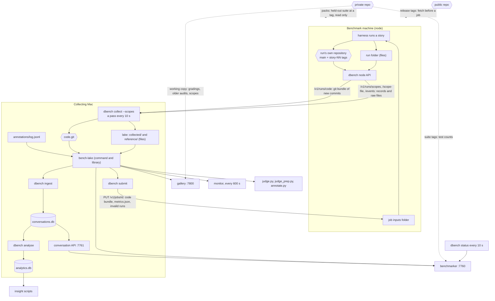
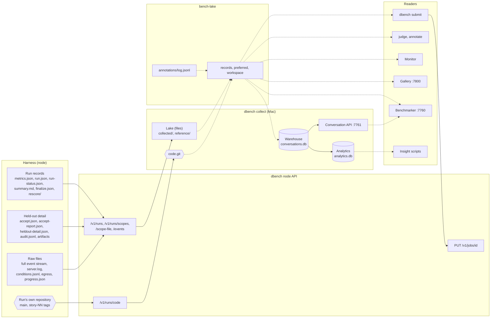
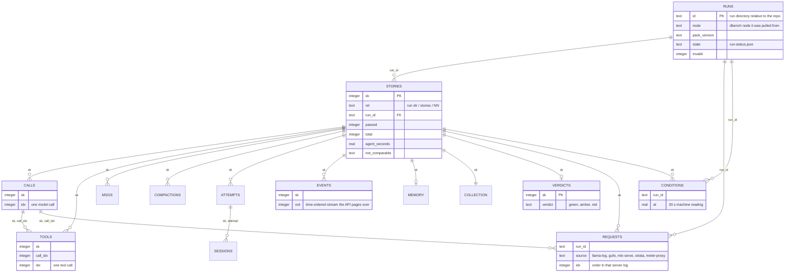
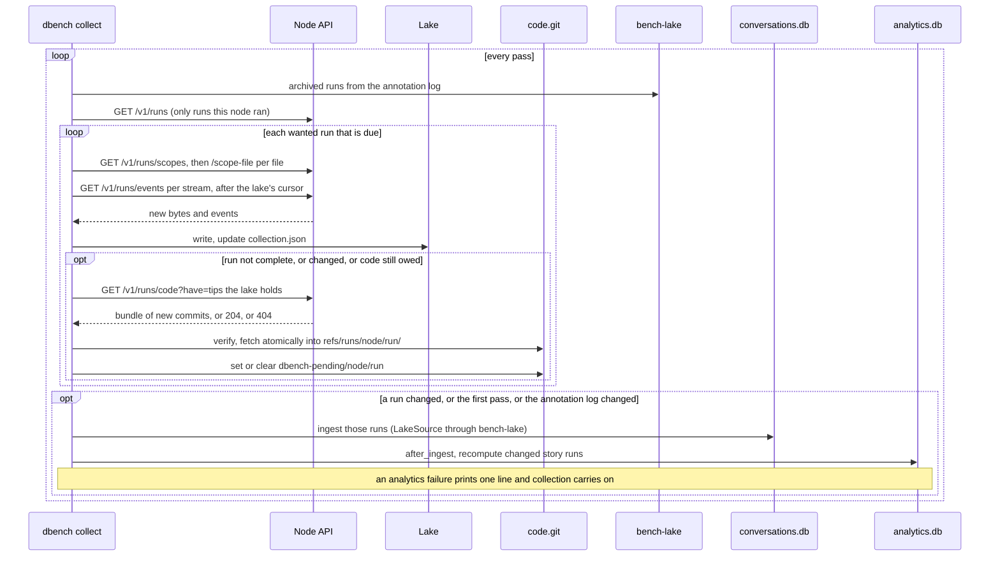
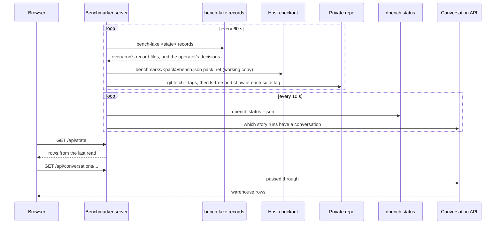
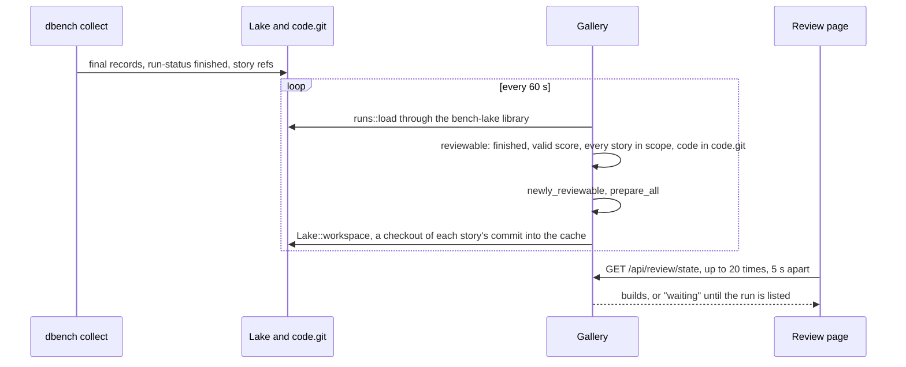
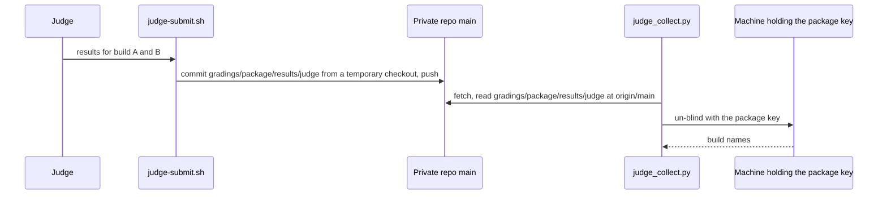

# Data provenance and flow

Where each piece of benchmark data is made, where it is copied to, what reads it, and how old
it can be when it gets there. Written from the code (file and function named beside each
claim), not from other documents. What was not traced is listed at the end; read that section
before relying on this one.

Checked against commit `7b9b82749` on main (7 Nov 2026), after story 23: the harness no longer
commits or pushes anything, and every reader of run data reads the lake.

## The stores

| Store | Where it lives | Written by | Holds |
|---|---|---|---|
| **Run folder** | the node's checkout of the public repo, `<results root>/combinations/…/benchmarks/<pack>/<run>/` (`roots.results_root`, `$SPEC_BENCH_RESULTS_ROOT`) | the harness (`drive.main`, `record_event.py`, `finalize.py`) | everything a run records except its code; never committed |
| **Run's own repository** | the node's work folder, `~/.w/<id>/workspace` (`drive.work_dir_for`, `WORK_ROOT`); the run folder names it in `work_dir.txt` | the agent's commits, and the harness's (`drive.snapshot_story`, `drive.tag_story`) | the run's code: its `main` branch and a `story-NN` tag on each story's last commit |
| **Lake, collected** | `<state>/collected/<node>/<run path>/` on the collecting Mac | `dbench collect` (`tools/dbench/src/collector.rs`) | copies of the files the allow-list takes (`collect.rs`), plus `collection.json` |
| **Lake, reference** | `<state>/reference/<pack>/<stack>/<run>/` (`collector::dest_dir`, `cli::DEFAULT_REFERENCE_DIR`) | `dbench collect` | the record files of reference-model runs (`collector::classes_for`) |
| **Code repository** | `<state>/code.git`, bare (`lake_code.rs`, `bench_lake::code::CODE_REPO`) | `dbench collect` (`collector::pull_run_code`), and once `dbench code-import` from old bundles (`lake_code::import_bundles`) | every run's commits, under `refs/runs/<node>/<run>/heads/*` and `refs/runs/<node>/<run>/story/NN` |
| **Annotation log** | `<state>/annotations/log.jsonl`, owner-only (`bench_lake::annotations`) | `bench-lake <state> annotate` | the operator's decisions: a run invalid, a run archived, a story not comparable |
| **Warehouse** | `conversations.db` on the collecting Mac | `dbench ingest`, run by the collector after a pass (`collector::pass_profiled`) | conversations: story runs, calls, tool calls, timings, early-end verdicts |
| **Analytics** | `analytics.db`, beside the warehouse | `dbench analyse`, run by the collector after an ingest (`analytics::after_ingest_profiled`) | derived thinking tables; the insight scripts add `theme*` tables |
| **Job inputs** | the node's `<jobs dir>/<id>.inputs/` (`job_inputs::dir`) | the node's dbench server, from the PUT that submits the job (`server.rs`, `job_inputs::store`, `store_invalid`) | a partial rerun's `code.bundle` and `metrics.json`; every job's `invalid-runs.json` |
| **Public repo** | GitHub | people; `dbench harness-release` (tags) | the harness code and its release tags; run records committed before story 23 |
| **Private repo** | GitHub | people; `judge-submit.sh` | the held-out packs and their version tags, the judges' exchange (`gradings/`), older audits under `runs/` |

`<state>` is a folder of the private repo's checkout on the collecting Mac. The benchmarker,
the gallery and `benchlake.py` all default it to `../awesome-local-ai-bench-private/state`
beside the public checkout (`tools/benchmarker/server/main.ts`, `vidi-gallery/src/main.rs`
`private_repo`, `harness/benchlake.py DEFAULT_STATE`). The private repo's `.gitignore` ignores
`/state/`, so none of it is committed there.

## The flow

Shapes: a **cylinder** is a database (a SQLite file, `conversations.db` and `analytics.db`
only). A **hexagon** is a git repository. A plain **box** is a component, or a folder of files.



## What a run folder holds, and what the collector takes

Nothing is published from a node. After each story run with `--record` the harness calls
`drive.prepare_records(run)`, which does two things in the run folder and nothing else
(`drive.py`):

- `heldout.make_public(run)`: writes a counts-only summary beside every held-out result
  (`accept-summary.json` beside `accept.json`, `accept-final-summary.json` beside
  `accept-final.json`), splits every `metrics.json` into a `metrics.json` without held-out detail
  and a `heldout-detail.json` beside it, and redacts `summary.md`, keeping the full text in
  `summary-detail.md`.
- `drive.make_publishable(run)`: replaces the home path with `~` in the text files of the run
  folder, except the files git ignored and the lake-only ones (`_not_committed`: `work_dir.txt`,
  `current_story`, `progress.json`, `conditions.jsonl`, `publicise.is_lake_only_in_run`).

`record_event.py` (run from `run.sh` at start, stop, failure and finish) writes
`run-status.json` and calls `prepare_records`. `finalize.py` writes `finalize.json` and
`rescore/<version>/` into the run folder. Neither commits. `test_no_publish.py` reads the
harness's own sources and fails on any git command that writes history (commit, push, rebase,
bundle, reset, merge, cherry-pick, am) outside the functions it names, all of which work on the
run's own repository or on the judge's scratch copy; of the shell scripts only
`judge-submit.sh` may.

Both forms of every held-out file stay in the run folder, and the collector takes both. The
split into public and private files no longer decides where a file goes; the allow-list does.

### What the collector takes

The node lists and serves only the files its allow-list names (`collect.rs`, `parse_name`); a
test at the end of `collect.rs` requires every file name the harness can write to be in exactly
one of the two lists. `dbench collect --list-rules` prints them; this is its output at HEAD,
grouped. Kind: `append` is pulled from the lake's length after a prefix check, `whole` is
replaced, `blob` is pulled into a partial file and renamed into place.

| Class | Files |
|---|---|
| **raw** (append) | `stories/NN/agent-events.jsonl` (the full stream), `stories/NN/conditions.jsonl`, `server.log`, `proxy.log`, `egress.jsonl` (served from `<bench home>/egress/<id>.jsonl`, found through `work_dir.txt`: `collect::egress_path`), `requests.jsonl` |
| **record**, the run | `run.json`, `run-status.json`, `metrics.json`, `metrics.subagent.json`, `heldout-detail.json`, `progress.json`, `summary.md`, `summary-detail.md`, `finalize.json`, `server-health.json`, `flow-counts.json`, `machine-unfit.json`, `interventions.md`, `run-history.jsonl`, `workspace-git-log.txt`, `AUDIT.md`, `audit.jsonl`, `publish-refused.json`, `OMITTED.txt`, `README.md`, `accept-summary.json`, `accept-final.json`, `accept-final-summary.json` |
| **record**, a story | `stories/NN/prompt.md`, `base-commit`, `gate.json`, `gate.original.json`, `accept.json`, `accept-summary.json`, `accept-report.json`, `accept-final.json`, `accept-final-summary.json`, `agent-events.compact.jsonl.gz` |
| **record**, trees | `rescore/V/**`, `rescore-spoiled/V/**`, `superseded/NAME/**`, `base/**`, `prompts/**`, `agent-reports/**`, `stories/NN/artifacts/**`, `screenshots/**`, `pre-suite-fix/**`, `scoring-N/**` |

Not collected, with the reason the rules give (`collect::NOT_COLLECTED`):

| Name | Why |
|---|---|
| `workspace/**` | the agent's working tree: its commits reach the lake's code repository through the code route |
| `workspace.bundle` | the old carrier of the run's code |
| `control/**` | live control files, such as the operator's skip request |
| `current_story` | the live marker of the story now running |
| `work_dir.txt` | a machine path; the node reads it to find the egress log and the run's repository |
| `.gitignore` | written only by the old harness |
| `archived.json` | a marker the host once wrote, never a node |
| `.NAME.PID.tmp`, `.NAME.partial` | in-flight temporaries |

A reference-model run takes only the **record** class (`collector::classes_for`): its compact
conversation log comes, its full stream does not.

The harness at HEAD does not write `agent-events.compact.jsonl.gz`; I found no writer of it in
the harness. Runs from before carry it, and the readers fall back to it when there is no full
stream (`ingest/inputs.rs` `plan_inputs`, `claims.py`).

## Components and the data they own

Each component with the entities it makes (solid arrow: writes) and the entities it reads
(dotted arrow). Mermaid has no UML component diagram, so this is a flowchart with one box per
component.



## Data entities

The entities the warehouse holds, from `tools/dbench/src/ingest/schema.sql` (its header says
schema version 2; `user_version` and `db::SCHEMA_VERSION` are 3). `sk` is the integer key of a
story run, stable across re-ingest; a story's own id is `stories.rel`, `<run dir>/stories/NN`.
Columns are left out except the keys.



`VERDICTS` is the verdict on a story the operator ended early (can later stories build on it?).
It is worked out at ingest on the host from every run's records, the reference runs included,
against the runs that finished the story before it ended (`ingest/verdict.rs`,
`inputs::verdict_runs`); the harness no longer works it out. `analytics.db` is a separate file,
derived from the warehouse (`analytics/schema.sql`): `analytics_story`, `call_context`,
`think_text`, plus `theme`, `theme_story` and `theme_share`, which the insight scripts write and
a rebuild carries over (`analytics::carry_over`). `COLLECTION` records what each story run was
ingested from (`events_source` is `full`, `compact` or `none`) and how far.

## Key workflows

### 1. A story ends (harness, `drive.main`)

```mermaid
sequenceDiagram
  participant A as Agent
  participant WS as Run's own repository
  participant H as Harness
  participant RD as Run folder
  A->>WS: commits during the story
  H->>RD: accept.json (held-out result), gate, evidence
  H->>WS: snapshot_story: commit what the agent left uncommitted
  H->>WS: tag_story: git tag -f story-NN on HEAD
  H->>RD: metrics.json (with the story's commit), progress.json, workspace-git-log.txt
  opt --record
    H->>RD: report.write_summary, then prepare_records (make_public, make_publishable)
  end
  Note over H,RD: nothing is committed to the checkout or pushed; the collector takes the folder
```

A failure in `snapshot_story` or `tag_story` is recorded as a harness fault on the story
(`drive.derived`) and the story is recorded at the commit the repository has. A story run again
moves its tag (`tag -f`).

### 2. Collection and ingest (`dbench collect`, one pass every 10 s)

On this Mac the LaunchAgent `com.awesome-local-ai.dbench-collect` starts the collector with
`--scopes` (its plist, read on 7 Nov). Without `--scopes` the pass uses the older whole-file
routes and **does not pull code at all** (`collector::collect_node_with`: the code pull is under
`if scopes`).



- **Which runs a node offers:** only the runs it ran. `collect::is_own_run` needs `run.json`
  and `work_dir.txt` in the folder; `work_dir.txt` is written where the run runs and git never
  carried it, so a copy of another machine's run that git brought into the checkout is not
  listed, and a request for it is refused (`server::named_run`, `collect::is_run_dir`).
- **Which runs the collector wants:** every run but the archived ones (`collector::wanted`;
  `archived_runs` reads the annotation log through `ingest::inputs::decisions`). If the log
  cannot be read, nothing is skipped by the pull and the ingest does not run.
- **Where a run goes:** `<store>/<node>/<run path>/` for a combination run;
  `<reference>/<pack>/<stack>/<run>/` for a reference run, with no node in the path
  (`collector::dest_dir`). Reference runs **are** pulled, record class only.
- **The code pull** (`collector::pull_run_code`, `lake_code::pull_code`): the collector sends
  every commit the code repository holds for that copy as `have=`. The node runs
  `git bundle create - --branches --tags=story-*` in `<work dir>/workspace` without those
  commits (`scopes/code.rs bundle_of`) and streams it; nothing is written on the node. 204 means
  nothing new. 404 with a body (`E-CODE-NO-REPO`: no work folder or no repository) clears the
  owed mark; 404 with an empty body is taken as a node without the route. The bundle is verified
  and fetched with `--atomic`: branches to `refs/runs/<node>/<run>/heads/*`, `story-NN` tags to
  `refs/runs/<node>/<run>/story/NN`; a reference run's segment is `reference`
  (`collector::code_place`).
- **Owed code:** a pull that fails, or meets a node without the route, writes the empty file
  `<code.git>/dbench-pending/<node>/<run>` (`lake_code::mark_pending`); while it exists the code
  is pulled on every pass, even for a run whose files are complete (`collector::code_owed`).
- **Completeness:** a run is complete once its `run-status.json` is final, its job has ended,
  every file and stream is held to its end, and a look at least 60 s later shows no change
  (`collector::settle`, `scope_collect::collect_run`). A complete run is looked at again every
  hour (`collector::due`, `DEFAULT_FINISHED_RECHECK_MS`).
- **Disk:** a pass pulls nothing while the lake's disk has less than 10 GiB free
  (`collector::space_decision`, `DEFAULT_FREE_SPACE_MARGIN_GIB`).
- **Ingest selection:** the runs this pass changed; every run on the first pass and whenever the
  annotation log's length or modification time changes (`collector::ingest_selection`,
  `decisions_mark`). Within those, only stories whose input digest changed are re-ingested.

### 3. The benchmarker refreshes



`sources.loadRuns` builds every row from bench-lake's `records` answer; no git process reads
run data (`server/main.ts` header). A run marked invalid in the annotation log is dropped, and
its documents are not served at its address either (`loadRuns`, `spoiled`). Archived runs are
left out by bench-lake. Not-comparable stories are marked from the same decisions
(`notComparableOf`). Test counts per suite version come from the private repo's tags
(`sources.loadFlowCounts`), cached per tag.

### 4. The gallery picks up a finished run



The gallery no longer pulls a working copy (`vidi-gallery/src/main.rs rescan`, `RESCAN_EVERY`).
It reads the run list and decisions from the lake (`runs::load_with`; an unreadable annotation
log shows no run at all), and builds each story from `code.git` (`main::story_checkout`). It
still reads the private repo's working copy for the judges' results (`runs::judges`, under
`gradings/`), older audits (`runs::run_or_private`, `runs/<id>/audit.jsonl` when the lake copy
has none), the pack scopes, the pack version (`git describe --tags` on the private checkout) and
the review log (`analysis/story-reviews.csv`).

### 5. An independent judge's result comes back



Unchanged by story 23. The package the judge receives is made from the lake: `judge.py` takes
each build by run id through `benchlake.preferred` and its code through `benchlake.workspace`
(`bench-lake <state> workspace <run> <story> <dest>`).

### 6. A partial rerun is submitted

```mermaid
sequenceDiagram
  participant O as Operator
  participant D as dbench submit (host)
  participant BL as bench-lake library
  participant N as Node
  participant H as Harness
  O->>D: submit --from-run R --only N or --from-story N
  D->>BL: invalid runs from the annotation log
  D->>BL: copies of R; the preferred one first
  D->>D: git bundle of R's story refs up to N-1 from code.git, and R's metrics.json
  D->>N: PUT /v1/jobs/id with inputs and invalid_runs
  N->>N: store in jobs/id.inputs/: code.bundle, metrics.json, invalid-runs.json
  N->>H: run.sh --from-run R --from-code bundle --from-metrics file
  H->>H: known_good_base, setup_workspace_from: fetch the bundle, reset to the story's commit
```

`job_inputs::from_lake` refuses when story N is 1, when the lake has no copy of R, when no copy
has a story ref for N-1, when no such copy has `metrics.json`, or when the bundle and record
together exceed 32 MiB (`JOB_INPUT_LIMIT_BYTES`). The inputs are not part of the job's identity
or its JSON. Every job, partial or not, carries the invalid-run list when the host has a lake
(`main.rs`, `ctx.lake_state_if_any`); the node puts the file's path in `SPEC_BENCH_INVALID_RUNS`
(`runner.rs`), and `run.sh` passes it to `finalize_pending.py --invalid-from`. A node never reads
another run from its checkout (`drive.known_good_base` reads only the two files it was given).

## Provenance, by kind of data

### 1. Run records (lake)

- **Made by** the harness in the run folder: `metrics.json` after every story
  (`heldout.save_metrics`), `run-status.json` (`record_event.py`), `summary.md` and the summaries
  (`prepare_records`), `finalize.json` and `rescore/` (`finalize.py`). `run.json` is written by
  `run.sh`; I did not trace which line.
- **Moved by** `dbench collect`, through the node API, to the lake. Nothing goes through git.
- **Copies:** a run can have several copies in the lake, one per node folder, when older runs
  were carried between nodes by git before story 23. Every reader takes bench-lake's preferred
  copy (`Lake::preferred`).
- **Read by** the ingest (`LakeSource`), the benchmarker, the monitor, the gallery, `judge.py`,
  `judge_prep.py`, `annotate.py`, and `dbench submit` for a partial rerun.
- **Old records** committed before story 23 are still in the public repository: at HEAD,
  `git ls-files` lists 141 `metrics.json` under `combinations/` and `benchmarks/reference/`,
  99 compact logs under `benchmarks/reference/` and 72 `workspace.bundle` files. Nothing adds to
  them, and no reader reads them from git.

### 2. Held-out detail

- **Made by** the harness: `accept.json`, `accept-report.json`, `accept-final.json`,
  `heldout-detail.json`, `summary-detail.md`, audits, `artifacts/`, `screenshots/`, `scoring-N/`.
- **Kept** in the run folder beside its summary, and **collected** into the lake (record
  class). The harness no longer copies it to the private repo.
- **Older detail** is in the private repo under `runs/<run path>/`, from before; the gallery
  falls back to it for `audit.jsonl` (`runs::run_or_private`).

### 3. Raw files (lake)

- **Made by** the harness on the node: `agent-events.jsonl` (full stream), `conditions.jsonl`
  per story, `server.log`, `proxy.log`, `requests.jsonl`, the egress log, `progress.json`.
- **Moved by** `dbench collect`: with `--scopes` the event streams (`agent`, `conditions`,
  `egress`) are read by cursor from `/v1/runs/events`, and the other files by
  `/v1/runs/scope-file` (`scope_collect.rs`). A stream line without its newline, or one that is
  not a JSON object, never reaches the lake. Without `--scopes`, an append-only file resumes
  from its local length after a prefix check of the last 4096 bytes, and a file the node
  rewrote is fetched again from 0.
- **Not taken from reference runs** (`collector::classes_for`).
- **`collection.json`** records bytes, times, cursors and completeness only.

### 4. A run's code (`code.git`)

- **Made by** the agent and the harness in the run's own repository on the node; each story's
  last commit is tagged `story-NN` (`drive.tag_story`).
- **Moved by** the collector's code pull (workflow 2). Before that, `dbench code-import` took
  the `workspace.bundle` files already in the lake into `code.git` once, with story refs from
  each copy's `metrics.json` (`lake_code::import_bundles`). Bundles are no longer collected.
- **Read by** bench-lake's `workspace` (a checkout of one story's commit into a folder outside
  the lake: `bench_lake::code`), which the gallery, `judge.py` and `judge_prep.py` use; and by
  `dbench submit` for a partial rerun's bundle. `finalize.py` re-scores from the run's own
  repository on the node, and only when that is gone from an old run's `workspace.bundle` in
  the run folder (`finalize.code_of`).
- **Kept on the node** after the run: once a run is finished and its final re-score is done,
  `finalize.py --release-work` (called at the end of `run.sh`) deletes the work folder except
  `workspace/.git`, so the node can still serve the code (`finalize.release_work`). A stopped,
  failed or unscored run keeps its whole work folder.

### 5. The operator's decisions (`annotations/log.jsonl`)

- **Made by** `bench-lake <state> annotate set|clear <kind> <run> [--story N] --reason …`, or
  once by `annotate import <checkout>` from the old markers (`bench-lake/src/cli.rs`). Kinds:
  `invalid`, `archived`, `not-comparable`. Append-only; the state of a (run, story, kind) is its
  last event (`annotations.rs`).
- **Read by** the collector (archived runs not pulled), the ingest (archived runs left out,
  invalid runs marked), bench-lake `records` (archived runs left out; each run's decisions given
  to the benchmarker), the gallery, and `dbench submit` (the invalid list sent with every job).

### 6. The warehouse, `conversations.db`

- **Inputs:** each combination run's preferred lake copy, read through the bench-lake library
  (`ingest/inputs.rs LakeSource`, no git): the record files, the full stream if the lake has
  one, else the compact log, and the lake's server log, conditions and flags. With `--worktree`
  it reads a directory tree laid out like the repository instead (`TreeSource`, for tests).
- **When:** see workflow 2. The collector runs the ingest only when a `repo` is configured
  (`collector::pass_profiled`: `cfg.repo` gates the ingest), though `LakeSource` does not use it.
- **Reference-model conversations are left out** (`PUBLISHED_ROOTS` is `combinations` only, and
  `db.rs` purges `benchmarks/reference/` rows); their records are read for the verdicts.
- **Read by** the conversation API (`127.0.0.1:7761`), which the benchmarker proxies.

### 7. Analytics, `analytics.db`

- **Made from** the warehouse, read-only, right after each ingest. A pass that ingested nothing
  skips it if the file exists (`analytics::after_ingest_profiled`).
- **Its failure never stops collection:** it prints one line and the loop carries on. The file
  can therefore fall behind the warehouse without anything upstream noticing.
- **Read by** the insight scripts in `benchmarks/docs/insights/thinking/`. Neither the
  benchmarker nor the gallery reads it.

## What still uses GitHub

| Use | Where | Direction |
|---|---|---|
| Harness releases | `dbench harness-release` tags a commit of main (`release.rs`); before a job the node fetches tags from origin (`harness.rs fetch`), finds the newest release merged into main and materialises it with `git archive` | public repo to node |
| The node's checkout | `git pull --ff-only` before each job unless the node's server was started with `--no-pull` (`runner.rs git_pull`, `cli.rs no_pull`); a failure is logged and the job runs on | public repo to node |
| Held-out packs | the harness finds the pack in the private checkout beside the public one (`packdir.py`) and takes the suite at the pack's tag from its git objects, fetching tags only when the tag is missing (`tagsuite.py`) | private repo to node, read only |
| Suite test counts | `git fetch --tags`, then `ls-tree` and `show` at each tag (`benchmarker sources.loadFlowCounts`) | private repo to the Mac |
| Judges' exchange | `judge-submit.sh` pushes `gradings/<package>/results/<judge>/`; `judge_collect.py` fetches and reads origin/main | both ways, private repo |
| Source watch | the monitor fetches origin/main for new commits, their authors, and whether the harness still imports (`monitor.collect_repo`); it reads no run data from git | public repo to the Mac |

No run data moves through GitHub.

## Conversations and token counts

Checked on 10 Oct 2026 against the code (`harness/clients.py`, `harness/accounting.py`, `harness/drive.py`,
`tools/dbench/src/ingest/`), against the live `conversations.db`, and against Anthropic's documentation for Claude Code.
Not re-checked for this revision.

### How each client is driven and what it logs

The harness starts one agent process per attempt (`drive.run_agent`) and reads its standard output line by line,
stamping each line with its arrival time (`_rx`) as it appends it to `stories/NN/agent-events.jsonl`. A story can need
several attempts: a fresh one, a resume after an error, a resume after a stop that is not a verified finish, a resume
after a harness restart (`drive.run_story_agent`).

| Client | Process | What the log holds | Output tokens per call | Output tokens per story |
|---|---|---|---|---|
| pi | one per attempt | token-by-token deltas, then the finished message | `message.usage.output` from the model server | sum of the calls |
| OpenCode | one per attempt | step events | `tokens.output` plus `tokens.reasoning` | sum of the steps |
| Claude Code | `claude -p <prompt> --model <id> --output-format stream-json --verbose --dangerously-skip-permissions`, with `--resume <session> --fork-session` on a retry | whole events (message blocks, tool calls, tool results, system notices), no deltas: the harness does not pass `--include-partial-messages` | none usable: the number on each assistant line is the API's count at the start of the response | the `result` line each process ends with: `usage.output_tokens`, with `thinking_tokens` |

For Claude Code, Anthropic's documentation says the per-message `output_tokens` "is only the count the API had reported at
`message_start`", and that the real count is added to the `result` message. In the opus-5.5 `v2-r1` story 4 log, the
assistant lines show 8, 8 and 16 and the `result` line shows 89,419 (28,534 thinking). `total_cost_usd` in the same line is
a client-side estimate from a bundled price table, not billing.

Each Claude Code process writes its own `result`, so a story that took several attempts has several. In `result`,
`usage` covers that process and `modelUsage` and `total_cost_usd` are cumulative for the session. The harness adds the
`usage` of every `result`.

### What the warehouse keeps of a conversation, and what it does not

`conversations.db` keeps the logical conversation: every turn's full thinking and reply text (`calls`), every tool call
with its arguments and full result (`tools`), the user messages (`msgs`), the compactions, and the order and call-level
times. It does not keep the stream. For a pi story, the raw file has 140,822 lines, of which 138,875 are deltas (38 of its
41.8 MB). The ingest skips them, along with `tool_execution_update`, `turn_start`, `turn_end`, `agent_end` and the like.
So it cannot rebuild:

- where the model's output was split into chunks, or when each chunk arrived (it keeps `sent`, `first` and the end per call);
- partial tool output while a command ran;
- the message envelope: `responseId`, `provider`, `api`, `rawStopReason`, `thinkingSignature`;
- the exact bytes: `clean()` in `ingest/flags.rs` rewrites `/home/<user>` and `/Users/<user>` to `~`.

The raw file stays in the lake and is the real archive. A Claude Code log has no deltas, so for Claude the warehouse is
closer to a full copy of the log than it is for pi.

### How far the token counts are verified

| Clients | Check | Result |
|---|---|---|
| pi on llama.cpp | the client's count per call against the model server's log, matched by **time** | 36,942 calls, zero differing |
| pi on gufo, mlx-serve, Strata; OpenCode on gufo | the same, but matched by **token counts**, so equality is by construction | 100% of calls found a server request with the same count, in order |
| pi on MTPLX | no server log | client count only (1,406 calls) |
| Claude Code, 55 stories with a raw log | the harness's recorded output tokens against the sum of the `result` events | 55 of 55 equal |
| Claude Code, the 6 stories with several `result` events | the sum of per-process `usage` against the last cumulative `modelUsage` | equal in all 6 |
| Claude Code, subagents | `usage` against `modelUsage` in the 49 single-result stories | equal, so no subagent tokens missing |

**Not done:** the Claude totals have not been compared with Anthropic's billing (the Console Usage page or the Usage and
Cost API). They show the harness read Claude Code's report correctly, not that the report matches the bill.

### Where tok/s comes from

- **Local models:** the model server's generated tokens over the server's decode seconds (`gen_n` over `gen_ms` for
  llama.cpp). Per story, the sum of tokens over the sum of those seconds (`accounting.py`).
- **Claude Code:** none. No per-call counts and no first-token time, so `decode_tokens`, `decode_tok_s` and
  `prefill_tok_s` are null in `time_split`. The benchmarker's "effective story tok/s" is the story's output tokens over its
  whole agent time, tool runs and waits included, and the page hides the engine speed for cloud rows.

## The readers and how old their data can be

Every reader of run data reads the lake through bench-lake: the command, or the library linked
into a Rust program. None reads a checkout or git for run data.

| Reader | Reads | How | Refresh |
|---|---|---|---|
| **Collector, ingest** `tools/dbench/src/ingest/inputs.rs` | the lake, the annotation log | bench-lake library (`LakeSource`) | after any pass that changed a run; pass every 10 s |
| **Benchmarker** `tools/benchmarker/server/sources.ts` | the lake and decisions; the conversation API; `dbench status`; each pack's `bench.json` from the host checkout's working copy; suite tags from the private repo | `bench-lake <state> records` | lake every 60 s; dbench and conversations every 10 s |
| **Monitor** `ops/monitor/monitor.py` | the lake's watched records; the benchmarker's fault feed; dbench | `bench-lake <state> records` (`collect_lake`) | one tick every 600 s (`TICK_S`) |
| **Gallery** `tools/vidi-gallery/src/runs.rs`, `main.rs` | the lake, decisions and `code.git`; the private working copy for gradings, older audits, scopes, version | bench-lake library (`runs::load`, `Lake::workspace`) | every 60 s (`RESCAN_EVERY`) |
| **Judge and annotate tools** `harness/judge.py`, `judge_prep.py`, `annotate.py` | the lake and `code.git` | `bench-lake` command via `benchlake.py` | when run |
| **dbench submit** `tools/dbench/src/job_inputs.rs` | the lake, `code.git`, decisions | bench-lake library | when run |

So a story's record reaches the lake on the collector's next pass that looks at the run (within
about 10 s while the run is open), the warehouse in the same pass, the benchmarker and the
gallery within a further 60 s, and the monitor within 600 s. A run marked complete is looked at
only once an hour, so a change to it after that (a late `finalize.json`, say) can take up to an
hour to arrive; its code follows on the same look unless a pull of it is owed, in which case it
is tried every pass.

## What was not traced

- Which line writes `run.json`, `server-health.json`, `flow-counts.json`, `requests.jsonl` and
  the other allow-listed files I named only from the rules; I read the rules, not every writer.
- Whether every node runs the dbench build with `/v1/runs/code` and `/v1/runs/scopes`; the
  release note says story 23 reached the nodes on 7 Nov, and I did not query them.
- Whether the collector's `dbench-pending` folder is empty now, and whether `analytics.db` is
  level with `conversations.db`.
- Whether anything other than `finalize.release_work` ever removes a work folder, or its
  `workspace/.git`, on a node; that would end the node's ability to serve the run's code.
- What bench-lake's preferred-copy ranking (`compare_copies`) weighs.
- What updates the private working copy on the Mac that runs the gallery, which still reads
  gradings and older audits from it.
- Whether the Claude Code token totals match Anthropic's billing.
